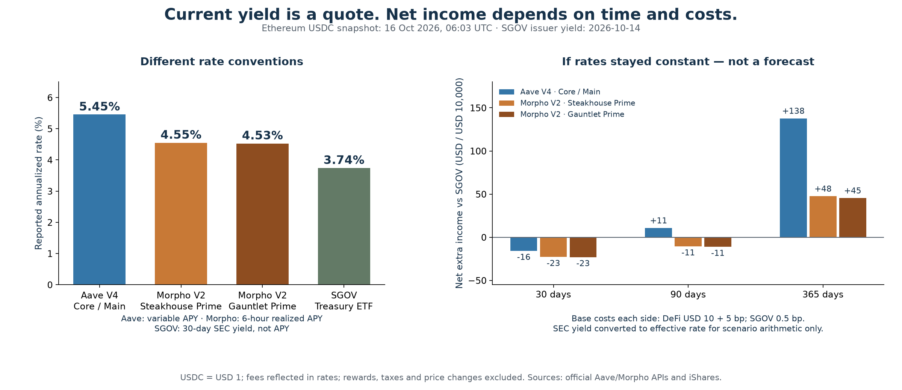
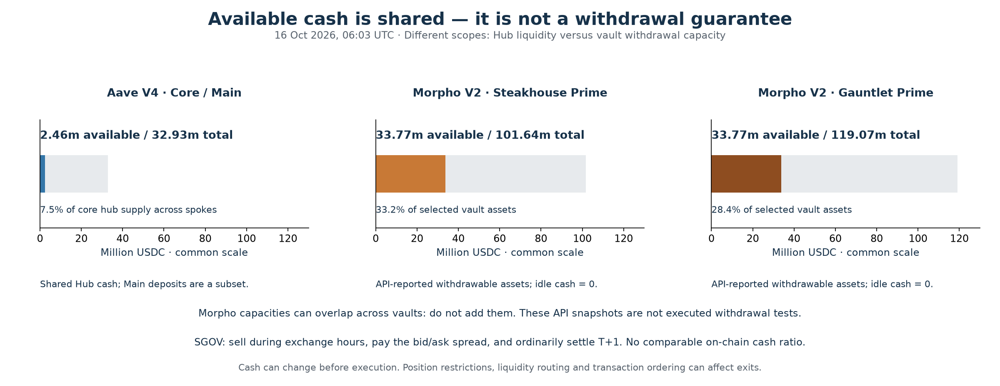

# USDC Lending: Current Yield, Costs and Withdrawal Liquidity

**[Read the executed notebook](notebooks/01_usdc_yield_and_liquidity.ipynb)** · **[Reproduce it](#reproduce)** · **[Exact sources and contracts](docs/DATA_SOURCES.md#current-v4v2-snapshot)**

## Current comparison: Aave V4 and Morpho Vaults V2

Snapshot: **15 October 2026, 23:03 PDT / 16 October, 06:03 UTC**. Ethereum native USDC; selected products, not an exhaustive ranking.

| Product | Reported annualized rate | What the rate measures |
|---|---:|---|
| Aave V4 Core / Main | 5.45% | Current variable supply APY |
| Morpho V2 Steakhouse Prime USDC | 4.55% | Six-hour realized post-fee APY |
| Morpho V2 Gauntlet USDC Prime | 4.53% | Six-hour realized post-fee APY |
| SGOV Treasury ETF | 3.74% | 30-day SEC yield, as of 14 October; **not APY** |

The current quotes have a larger advantage than the older historical results suggest. But **a quoted rate advantage is not a realized return**. Under a constant-rate illustration with USD 10,000 and base entry/exit costs, Aave is about **USD 11 ahead of SGOV after 90 days**; the two Morpho vaults are about **USD 11 behind**. All three lag at 30 days and lead at 365 days **if these rates persist**. [Unrounded rates](reports/current_rates.csv) · [108 cost and holding-period scenarios](reports/current_scenarios.csv).



Base costs each side: DeFi USD 10 + 5 bp; SGOV 0.5 bp and no commission. Rates include embedded fees. The SEC yield is converted to an effective rate for scenario arithmetic only. Assume USDC = USD 1; exclude rewards, tax and price changes. Costs are assumptions, not observed fills. [Method](docs/CURRENT_COMPARISON.md).

## Check cash access separately

Aave's **Core Hub** reported **2.46m USDC** available against **32.93m** supplied, shared across Spokes. Each selected Morpho V2 vault reported about **33.77m USDC withdrawable**, against different vault totals; these capacities can overlap and must not be added. Neither is a guaranteed wallet withdrawal. SGOV sells during market hours and ordinarily settles T+1.



The notebook explains rate conventions, 30-day Morpho context, cost sensitivity, exact identities and limits. It is built from saved official API responses and issuer extracts, not screenshots. [Verification summary](reports/current_checks.json) · [data hashes](data/current_manifest.json).

## Watch the summary

**[Captioned 38-second video](animations/usdc_lending_linkedin.mp4)** · [Preview and reproduce](animations/README.md). Current quotes, the 90-day cost illustration and withdrawal constraints; April V3 is explicitly historical context. Synthetic Voicebox narration, subtitles below the charts, educational disclaimer.

[](animations/usdc_lending_linkedin.mp4)

## Historical evidence stays separate

- **[Historical V3/V1 versus SGOV](notebooks/03_historical_treasury_comparison.ipynb):** matched-period earned returns, June 2024–October 2026. The old yield advantage narrowed; USD 10,000 earned USD 58–85 extra over 866 days after base costs.
- **[Historical liquidity appendix](notebooks/02_liquidity_details.ipynb):** archived cash observations, including 6,519 USDC available in **Aave V3 Ethereum Core** on 21 April 2026. This is not a V4 stress test or evidence of realized USDC loss.
- [Historical findings](reports/FINDINGS.md) · [Treasury accounting checks](reports/treasury_checks.json) · [ETH drawdown diagnostic](reports/DRAWDOWN_DIAGNOSTIC.md).

The newer contracts have different exposures and mechanisms. We never splice V3/V1 history into a V4/V2 return series.

## Reproduce

All numerical inputs are committed. Analysis and notebook execution run **offline, without an API key or wallet**. Clone this public repository, then run:

```bash
git clone https://github.com/fredLuv/defi-lending-research.git
cd defi-lending-research
python3.11 -m venv .venv
source .venv/bin/activate
python -m pip install -r requirements.lock
python -m pytest -q test_current.py test_treasury.py test_analysis.py
python build_notebook.py
```

The builder verifies saved source hashes and identities, independently reconstructs every cost scenario using high-precision arithmetic, regenerates both current figures, and executes `notebooks/01_usdc_yield_and_liquidity.ipynb` top to bottom. No system-wide kernel installation is required.

Optional historical notebooks:

```bash
python build_historical_notebook.py
python build_liquidity_appendix.py
```

### Collect a new current snapshot

Preserve the committed vintage first (use another checkout or branch). Then:

```bash
python collect_current.py --refresh
python -m pytest -q test_current.py
python build_notebook.py
```

The collector makes read-only requests to the official Aave V4 and Morpho APIs and iShares. It records queries, raw responses, retrieval times, Morpho indexed blocks and checksums. Aave is not block-pinned; requests are not atomic. A refresh changes the vintage: review the new outputs and update any prose/video before sharing. No transaction is signed or sent.

### Recollect the separate historical inputs

```bash
python collect.py --smoke
python collect.py --workers 4
python collect_treasury.py --refresh
python build_historical_notebook.py
```

Historical contract collection is resumable and requires an archive-capable Ethereum RPC (default [dRPC](https://eth.drpc.org); override `ETH_ARCHIVE_RPC`). To recollect from scratch, use a separate copy with its `data/raw/states/` removed, preserving the original archive. Issuer downloads can contain revisions; retain and compare their hashes. [Historical source catalogue](docs/DATA_SOURCES.md).

## Interpretation

This comparison describes selected products and dated evidence. It does not estimate default probabilities, establish that yields compensate for all risks, or guarantee an exit. Contract/collateral losses, stablecoin depegging, taxes, rewards and actual wallet execution are outside the cost scenarios. A useful interface should compare **net income for your amount and holding period**, **rate conventions**, and **withdrawal constraints**, rather than rank APYs alone.

## License and attribution

Original analysis code is MIT-licensed; see [LICENSE](LICENSE). Public-source data and third-party tools retain their own terms; see [NOTICE](NOTICE.md) and the [source catalogue](docs/DATA_SOURCES.md). This is a standalone DeFi study.

For educational purposes only. Not financial advice.
