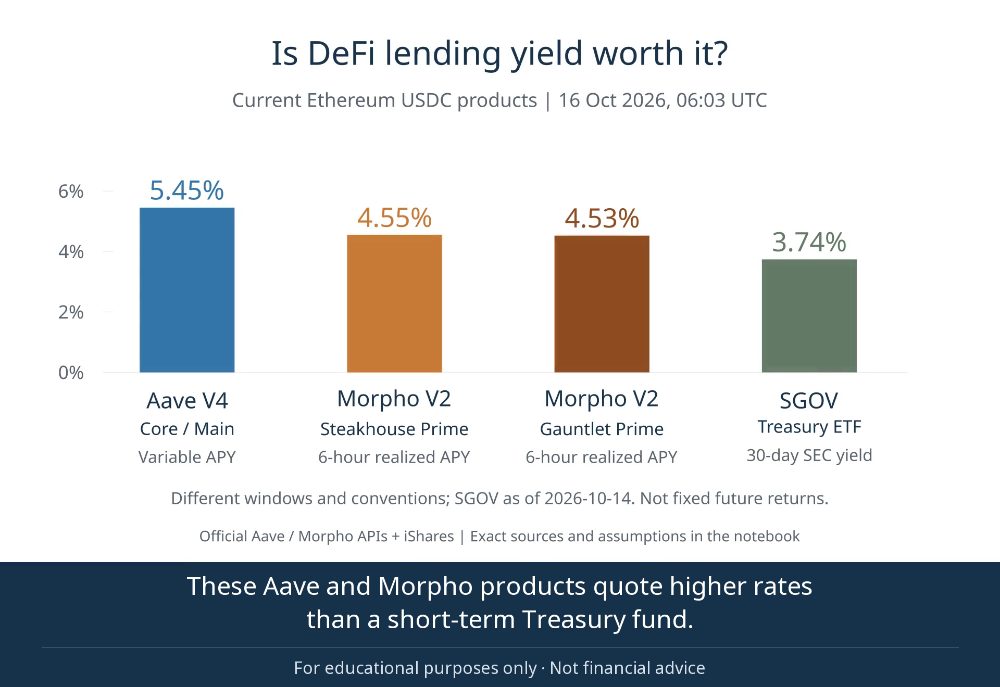

# USDC lending: an animated comparison

[Watch the captioned LinkedIn version](usdc_lending_linkedin.mp4) · [Voicebox version without captions](usdc_yield_liquidity_voicebox.mp4) · [Silent version](usdc_yield_liquidity.mp4) · [Source catalogue](../docs/DATA_SOURCES.md)

[](usdc_lending_linkedin.mp4)

## What it shows

**Current snapshot: 16 October 2026, 06:03 UTC (15 October, 23:03 PDT).** The video follows the executed notebook; its data was validated before rendering. [Current notebook](../notebooks/01_usdc_yield_and_liquidity.ipynb) · [raw-response manifest](../data/current_manifest.json).

1. **0–12 seconds:** Aave V4 Core/Main 5.45% variable supply APY; Morpho Vaults V2 Steakhouse Prime 4.55% and Gauntlet Prime 4.53%, six-hour realized post-fee APYs; SGOV 3.74% 30-day SEC yield as of 14 October. These conventions and observation windows differ. None is a locked forward return.
2. **12–20 seconds:** USD 10,000 over 90 days, if rates remained constant. Extra income versus SGOV after base costs is approximately **+USD 11 for Aave, −USD 11 for each Morpho vault**. Each-side costs: DeFi USD 10 + 5 bp; SGOV 0.5 bp. SEC yield is converted to an effective rate for scenario compounding. USDC is valued at par; rewards, tax and market-price changes are excluded. This is an illustration, not a forecast.
3. **20–31 seconds:** current API-reported capacity: Aave Core Hub about 2.46m USDC; each selected Morpho V2 vault about 33.77m. Hub cash is shared; vault capacities may overlap and cannot be added. These are not guaranteed wallet withdrawals. SGOV uses market-hours sales and ordinary T+1 settlement. A separate historical callout identifies **Aave V3 Core's 6,519 USDC observation on 21 April 2026**; it is not evidence about V4 or proof of realized loss.
4. **31–38 seconds:** **earnings after fees and access to your money**. Better UX should show the user's amount, holding period and withdrawal constraints, beyond an APY ranking. The final slide displays `github.com/fredLuv/defi-lending-research` for the public notebook, code and data.

The older narrowing-spread result belongs to the [historical V3/V1 notebook](../notebooks/03_historical_treasury_comparison.ipynb), not today's products. The old [Samantha narration file](usdc_yield_liquidity_narrated.mp4) is an archived **V3/V1 historical version**, not the current comparison.

The current narration uses **Voicebox's Kokoro backend and the Heart preset**, a synthetic voice, at normal speed. The narration uses plain language and identifies the USD 11 example as extra income **relative to the Treasury fund**, conditional on rates staying constant. [Voiceover script](voicebox_narration.json) · [caption text](linkedin_captions.srt) · [suggested LinkedIn wording](linkedin-caption.md).

The LinkedIn export adds a **240-pixel subtitle band below the 1920 × 1080 charts**. It never covers or crops them. A persistent line reads **“For educational purposes only · Not financial advice.”** Output is 1920 × 1320; the Voicebox audio is copied unchanged. Captions are phrase-level editorial cues, not word-level forced alignment.

## Reproduce

Use a separate Python 3.14 environment; leave the study's Python 3.11 environment unchanged. From the repository root:

```bash
uv venv --python 3.14 .venv-animation
uv pip install --python .venv-animation/bin/python -r animations/requirements.lock
.venv-animation/bin/python animations/render.py
```

First run `python build_notebook.py` in the analysis environment. The renderer reads the checked current rates/scenarios and historical cash observation offline, verifies snapshot hashes and cost arithmetic, and writes the MP4 plus its checksum manifest. It does not recollect data or alter research results. FFmpeg creates the preview at six seconds. A refreshed vintage requires reviewing the narration, captions and interpretation before sharing.

Optional layout inspection:

```bash
.venv-animation/bin/manimgx inspect animations/lending_story.py
```

### Voicebox neural narration

From the study directory, with `uv`, `git`, `ffmpeg` and `ffprobe` installed:

```bash
git clone https://github.com/jamiepine/voicebox.git .cache/voicebox
git -C .cache/voicebox checkout 8af7efe62fab8d33e2a5dfbedabaa45f68a5184f
uv venv --python 3.12 .venv-voicebox
uv pip install --python .venv-voicebox/bin/python -r animations/requirements-voicebox.lock
.venv-voicebox/bin/python animations/voicebox_narration.py
```

The script calls the actual `KokoroTTSBackend.generate` implementation from that Voicebox checkout; the desktop frontend is not required. Kokoro-82M weights and the `af_heart` preset are downloaded at a fixed Hugging Face revision, then inference runs locally on four CPU threads. The original video stream is copied without re-encoding. There is no voice cloning, cloud synthesis, paid API or playback-speed increase. Cached speech takes permit resuming; each segment must fit its scene or the build stops. A temporary short-path dictionary copy handles an eSpeak native-loader limitation under long project paths.

[Voicebox manifest](voicebox_manifest.json) records model/voice hashes, seed, timings and output checksum. Voicebox is MIT-licensed; the [Kokoro model](https://huggingface.co/hexgrad/Kokoro-82M) is Apache-2.0. Model weights and the third-party source checkout remain in local caches, outside Git.

### Captioned LinkedIn export

After rendering and adding Voicebox narration:

```bash
.venv-animation/bin/python animations/build_linkedin_video.py
```

This uses Pillow and the pinned Noto Sans font to lay out the band, then FFmpeg to encode it below the charts. It checks subtitle bounds, ordering and duration. [Manifest](linkedin_video_manifest.json) records input/output hashes and the exact chart/subtitle regions. [Caption source](linkedin_captions.json) is editable independently of the narration.

The render performs layout inspection and writes ignored local storyboards. ManimGX 0.1.1 and its dependencies/fonts are pinned. Encoded bytes and runtime may vary across hardware; the source values and chart geometry should agree.

## Sources and tools

- **April event context:** the [Aave service providers' incident report](https://governance.aave.com/t/rseth-incident-report-april-20-2026/24580) dates the Kelp rsETH bridge exploit to 18 April 2026. Aave's smart contracts were not compromised. Our separate 21 April, 00:00 UTC snapshot at [Ethereum block 24,924,560](https://etherscan.io/block/24924560) records 6,519.184610 USDC available in Aave Ethereum Core; see the [liquidity audit](../reports/LIQUIDITY_DETAILS.md). The narration places that observation after the incident; it does not attribute every withdrawal to the exploit or infer a realized loss for USDC suppliers.
- [Historical Ethereum snapshots, exact Aave/Morpho contracts and references](../docs/DATA_SOURCES.md).
- **Current sources:** [Aave V4/Morpho V2 exact contracts and API definitions](../docs/DATA_SOURCES.md#current-v4v2-snapshot), [current rates](../reports/current_rates.csv), [cost scenarios](../reports/current_scenarios.csv), [snapshot hashes](../data/current_manifest.json).
- [Official iShares SGOV NAVs and distributions](https://www.ishares.com/us/products/314116/ishares-0-3-month-treasury-bond-etf); [frozen extract provenance](../data/treasury_manifest.json).
- [Exact return comparison](../reports/treasury_comparison.csv), [cost scenarios](../reports/treasury_cost_sensitivity.csv), [daily cash observations](../data/processed/daily_panel.csv).
- [ManimGX](https://github.com/academa-labs/manimgx) and [rendering documentation](https://manimgx.academa.ai/llms.txt). Python API: MIT; bundled native encoder includes GPL-licensed x264 as described by the project. We distribute our scene and rendered media, not the renderer's binaries.

The final MP4 was decoded for inspection; representative frames and the renderer's complete play-end layout checks were reviewed. See [manifest.json](manifest.json) for the exact inputs and output hash.

The historical period spreads remain in the appendix. The current cost figures independently reconcile with the validated notebook; cash amounts come from the saved official responses. Rates and capacities are dated observations, not live guarantees.
