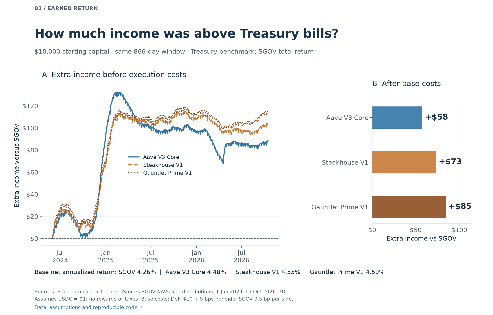
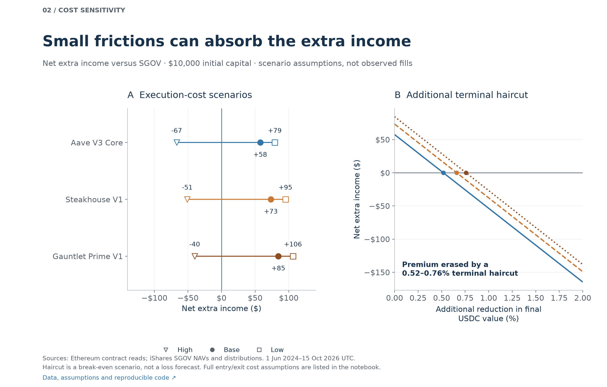
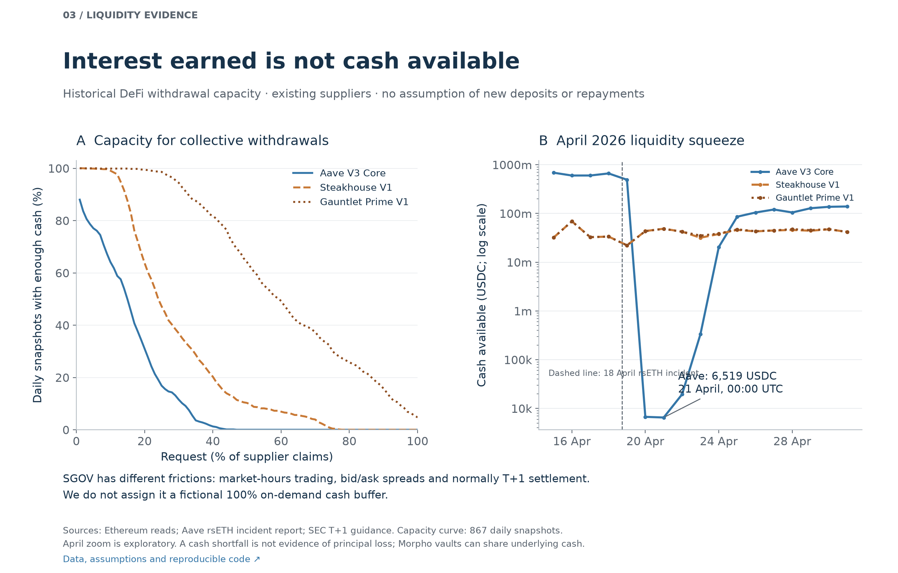

# DeFi lending versus Treasury bills

**After illustrative base costs, \$10,000 in the three selected DeFi positions earned \$58–\$85 more than SGOV over 866 days.** That is an annualized advantage of **0.23–0.34 percentage points**. This modest premium is conditional on USDC converting at par; it is not a complete price of liquidity or principal risk.

[Executed notebook](../notebooks/01_usdc_yield_and_liquidity.ipynb) · [reproduce](../README.md#reproduce) · [data sources](../docs/DATA_SOURCES.md) · [benchmark design](../docs/TREASURY_COMPARISON.md).

## Matched-period comparison

1 June 2024 00:00–15 October 2026 00:00 UTC. SGOV is an **ETF holding 0–3 month Treasury securities**, rather than a directly held bill ladder. Its return includes NAV changes and reinvested distributions, after fund expenses. Each UTC observation uses the most recent preceding NAV; the endpoint NAV dates are 31 May 2024 and 14 October 2026.

| Product | Net annualized return | Net profit per \$10,000 | Extra versus SGOV | Annualized advantage |
|---|---:|---:|---:|---:|
| Treasury ETF: SGOV | 4.26% | \$1,039.50 | — | — |
| Aave V3 Ethereum Core | 4.48% | \$1,097.01 | \$57.51 | 0.229 pp |
| Morpho Steakhouse USDC V1 | 4.55% | \$1,112.87 | \$73.37 | 0.291 pp |
| Morpho Gauntlet USDC Prime V1 | 4.59% | \$1,124.03 | \$84.52 | 0.336 pp |

**Base cost assumptions, each side:** DeFi \$10 fixed plus 5 basis points conversion spread; SGOV 0.5 basis point execution spread, with zero commission. Entry costs reduce the invested capital and exit costs reduce final proceeds. Vault and fund fees are already reflected. Rewards and taxes are excluded. These are scenarios, not observed historical fills. [Exact results](treasury_comparison.csv).

Sources: [historical Ethereum contracts](../docs/DATA_SOURCES.md) and [official SGOV NAV/distribution data](https://www.ishares.com/us/products/314116/ishares-0-3-month-treasury-bond-etf). [Input hashes](../data/treasury_manifest.json).

## Costs and position size matter

For \$10,000, the assumed low-cost scenario produces \$79–\$106 excess income, while the high-cost scenario produces **\$40–\$67 less than SGOV**. Under base costs, all three DeFi positions underperform SGOV for a \$1,000 position because fixed costs consume more of the return. [All scenarios and definitions](../docs/TREASURY_COMPARISON.md) · [size sensitivity](treasury_cost_sensitivity.csv).

A further **0.52–0.76% reduction in terminal USDC value** would erase the base-case advantage at \$10,000. This is a break-even arithmetic calculation, not the probability or expected severity of a loss. It does not make the two investments equally risky.

Sources: the same saved return inputs; explicitly assumed execution costs and terminal haircuts. [Calculation code](../treasury_analysis.py).

## Income and access to cash are separate outcomes

At the sampled minimum on 21 April 2026, Aave had **6,519 USDC** available against approximately **2.095 billion USDC of supplier claims**. The observation matches across two RPC providers. It coincides with the documented rsETH incident; this analysis does not establish a realized USDC principal loss or attribute every withdrawal to that incident.

The selected Morpho vaults generally had larger relative cash buffers than Aave. They can nevertheless share the same underlying market cash, so their capacities are not additive. Higher yield did not consistently correspond to lower measured liquidity in this sample. [Detailed evidence](LIQUIDITY_DETAILS.md).

Sources: [exact contract reads](../docs/DATA_SOURCES.md), [independent minimum check](../data/raw/crosschecks/aave_minimum_1rpc.io.json), [Aave incident report](https://governance.aave.com/t/rseth-incident-report-april-20-2026/24580).

SGOV has a different exit mechanism: market-hours trading, bid/ask spreads and generally T+1 settlement. Its NAV is not a guaranteed executable price, and we did not measure historical trade capacity. We do not give it a fictional 100% immediate-cash score. [SEC settlement guidance](https://www.investor.gov/introduction-investing/general-resources/news-alerts/alerts-bulletins/investor-bulletins/new-t1-settlement-cycle-what-investors-need-know-investor-bulletin).

The [exploratory ETH drawdown diagnostic](DRAWDOWN_DIAGNOSTIC.md) does not support a simple claim that falling ETH prices always reduce available cash. Liquidity and collateral solvency are distinct, and a cash balance alone cannot measure overall risk.

## What this supports

Most of the observed DeFi yield was also available through the Treasury ETF. The incremental income was modest, cost-sensitive and accompanied by a different withdrawal mechanism. **These observations quantify the premium and some exit constraints; they do not establish that the premium adequately compensated every investor.**

The study covers three selected surviving products, one historical period and dependent snapshots. It does not comprehensively reconstruct depegs, incentives, executed withdrawals, contract failures, tax differences or future liquidity needs. Morpho V2 requires its own period and accounting; it is not represented by these V1 vaults. The April 2026 zoom was selected after seeing the minimum, unlike the three original event windows. No significance or causal claim is made.

A useful follow-up would estimate actual exit proceeds and time-to-cash across a broader vault universe, including rewards and V2 over a common window. [Validation](VALIDATION.md) · [full liquidity appendix](../notebooks/02_liquidity_details.ipynb).
